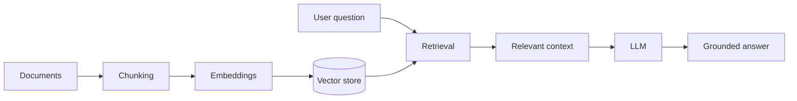

<div align="center">


<a href="https://readme-typing-svg.demolab.com">
  
</a>

<p>
  
  
  
</p>

</div>

---

## `whoami`

I'm **Qaisar Baloch**, a Computer Science Engineering student at the **University of Dunaújváros, Hungary**, working toward becoming a professional AI Engineer.

I'm interested in building practical applications with **Generative AI, Large Language Models (LLMs), Retrieval-Augmented Generation (RAG), AI agents, and automation**. I enjoy connecting models, APIs, data, and interfaces to turn ideas into useful products.

Beyond AI, I’m curious about **Data Science, Quantum Computing, electronics, microcontrollers (MCUs), and microprocessors (MPUs)**.

> **My direction:** build reliable, production-ready AI products and keep learning by creating.

## `current_focus`

| Focus | What I work on |
|---|---|
| Generative AI | LLM-powered applications and model APIs |
| RAG systems | Document processing, embeddings, retrieval, and vector search |
| Agentic AI | AI agents and multi-step workflows |
| AI engineering | APIs, application integration, and deployment |
| Emerging tech | Quantum computing, data science, and embedded systems |

## `tech_stack`

**Languages**


**AI, data & retrieval**


**LLM platforms & application tools**


## `featured_projects`

A selection of projects from my portfolio. Visit each repository for its source code, documentation, and implementation details.

<table>
  <tr>
    <td width="50%" valign="top">
      <h3>🛍️ <a href="https://github.com/Qaisar-baloch/shopAI">shopAI</a></h3>
      An AI-focused application project. Explore the repository for its current features and implementation.
    </td>
    <td width="50%" valign="top">
      <h3>📄 <a href="https://github.com/Qaisar-baloch/PDF-RAG-Chatbot">PDF RAG Chatbot</a></h3>
      A document-focused RAG project for asking questions about PDF content.
    </td>
  </tr>
  <tr>
    <td width="50%" valign="top">
      <h3>🧭 <a href="https://github.com/Qaisar-baloch/AI-LEARNING-ROADMAP-GENERATOR">AI Learning Roadmap Generator</a></h3>
      An AI-related learning roadmap generator. See the repository for its workflow and implementation.
    </td>
    <td width="50%" valign="top">
      <h3>🎯 <a href="https://github.com/Qaisar-baloch/The-Qualified-Path">The Qualified Path</a></h3>
      A platform supporting scholarship preparation and guidance for students.
    </td>
  </tr>
  <tr>
    <td width="50%" valign="top">
      <h3>🩻 <a href="https://github.com/Qaisar-baloch/Pneumonia-Detector">Pneumonia Detector</a></h3>
      A machine-learning project exploring pneumonia detection from chest X-ray images.
    </td>
    <td width="50%" valign="top">
      <h3>☁️ <a href="https://github.com/Qaisar-baloch/Cloudly-Saas-Analytics-Dashboard">Cloudly SaaS Analytics Dashboard</a></h3>
      A SaaS analytics dashboard project. Explore the repository for its interface and functionality.
    </td>
  </tr>
  <tr>
    <td width="50%" valign="top">
      <h3>🛰️ <a href="https://github.com/Qaisar-baloch/remote-sensing-communication-cansat">Remote Sensing Communication CanSat</a></h3>
      An engineering project connected to remote sensing and communication.
    </td>
    <td width="50%" valign="top">
      <h3>💡 <a href="https://github.com/Qaisar-baloch">More projects</a></h3>
      Explore my GitHub repositories for more experiments, learning projects, and development work.
    </td>
  </tr>
</table>

## `how_i_think_about_rag`

A simplified reference workflow for one of the areas I enjoy exploring. Individual projects may use different components and architectures.



## `currently_exploring`

- Improving the quality and reliability of RAG applications.
- Building useful LLM-powered tools and AI agents.
- Connecting AI backends with practical user-facing applications.
- Learning more about deployment and production-ready AI systems.
- Exploring Quantum Computing and the intersection of software and hardware.

## `github_analytics`

<div align="center">


</div>

## `contribution_snake`

The contribution snake is generated by GitHub Actions. It will appear after the workflow completes successfully and publishes the SVG to the `output` branch.

<div align="center">
  
</div>

<details>
<summary><strong>Set up the contribution snake</strong></summary>

Create `.github/workflows/snake.yml` in your profile repository (`Qaisar-baloch/Qaisar-baloch`) with:

```yaml
name: Generate contribution snake

on:
  schedule:
    - cron: "0 0 * * *"
  workflow_dispatch:

permissions:
  contents: write

jobs:
  generate:
    runs-on: ubuntu-latest
    steps:
      - name: Generate contribution graph
        uses: Platane/snk@v3
        with:
          github_user_name: Qaisar-baloch
          outputs: |
            dist/github-contribution-grid-snake.svg
            dist/github-contribution-grid-snake-dark.svg?palette=github-dark

      - name: Publish to output branch
        uses: peaceiris/actions-gh-pages@v4
        with:
          github_token: ${{ secrets.GITHUB_TOKEN }}
          publish_branch: output
          publish_dir: dist
</details>

After adding the workflow:
1. Open **Settings → Actions → General** in the profile repository.
2. Under **Workflow permissions**, allow read and write permissions.
3. Run **Actions → Generate contribution snake → Run workflow** once.
4. Confirm that the `output` branch contains the generated SVG.

</details>

## `connect`

I'm happy to connect with AI engineers, developers, researchers, and open-source contributors. Always open to learning, sharing ideas, and collaborating on meaningful projects.

<p>
  <a href="https://github.com/Qaisar-baloch"></a>
  <a href="https://linkedin.com/in/qaisar-khan-320a22421"></a>
  <a href="mailto:qaisarbaloch872@gmail.com"></a>
</p>

---

<div align="center">

*“The best way to predict the future is to build it.”*


</div>
