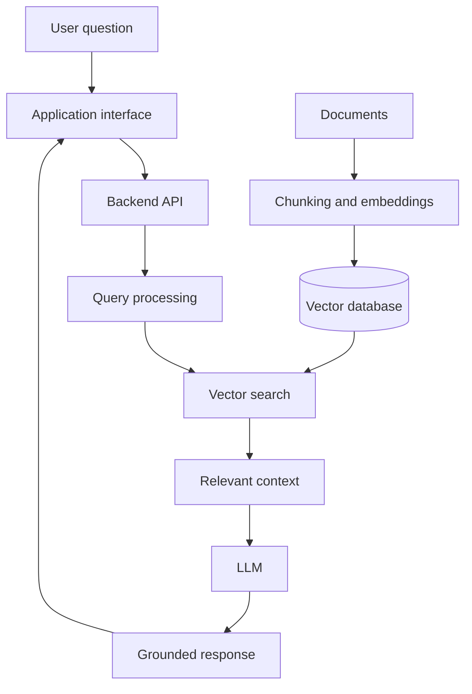

<!--
  Qaisar Baloch | GitHub Profile README
  Replace any placeholder links (especially social links) with your verified profile URLs.
-->

<div align="center">


<a href="https://git.io/typing-svg">
  
</a>

<p>
  
  
  
</p>

</div>

---

## ` whoami `

I'm **Qaisar Baloch**, a Computer Science Engineering student at the **University of Dunaújváros, Hungary**, focused on building practical intelligent systems.

My main interests are **Generative AI, Large Language Models (LLMs), Retrieval-Augmented Generation (RAG), AI agents, and AI-powered product development**. I enjoy taking ideas from experimentation toward useful applications, APIs, and automated workflows.

Alongside software and AI, I have hands-on experience and interests in **electronics, microcontrollers (MCUs), microprocessors (MPUs), and embedded systems**. I'm also curious about **Data Science and Quantum Computing**, especially where emerging technologies meet real-world engineering.

**My goal:** grow as an AI Engineer and build reliable, production-ready Generative AI products.

---

## ` focus_areas `

| Area | What I'm exploring |
|---|---|
| Generative AI | LLM-powered applications and model APIs |
| Retrieval-Augmented Generation | Document retrieval, embeddings, vector search, and FAISS |
| Agentic AI | AI agents and multi-step automated workflows |
| AI product engineering | Building interfaces, APIs, and deployable applications |
| Hardware & embedded systems | Electronics, MCUs, MPUs, and embedded technology |
| Emerging technology | Data Science and Quantum Computing |

---

## ` tech_stack `

**Languages**
<br/>


**AI, data & LLM tooling**
<br/>


**LLM APIs**
<br/>


**Application development & tools**
<br/>


---

## ` featured_projects `

A selection of projects from my repositories. Open each repository for its implementation, setup instructions, and current status.

<table>
  <tr>
    <td width="50%" valign="top">
      <h3>🛍️ <a href="https://github.com/Qaisar-baloch/shopAI">shopAI</a></h3>
      AI-focused project. Visit the repository for its feature set and implementation details.
    </td>
    <td width="50%" valign="top">
      <h3>🧠 <a href="https://github.com/Qaisar-baloch/RASAI-AI">RASAI-AI</a></h3>
      AI project. Explore the repository for its technical approach and capabilities.
    </td>
  </tr>
  <tr>
    <td width="50%" valign="top">
      <h3>📚 <a href="https://github.com/Qaisar-baloch/PDF-RAG-Chatbot">PDF RAG Chatbot</a></h3>
      A project in the Retrieval-Augmented Generation space, focused on chatting with PDF content.
    </td>
    <td width="50%" valign="top">
      <h3>🗺️ <a href="https://github.com/Qaisar-baloch/AI-LEARNING-ROADMAP-GENERATOR">AI Learning Roadmap Generator</a></h3>
      An AI-related learning roadmap generator. See the repository for the workflow and implementation.
    </td>
  </tr>
  <tr>
    <td width="50%" valign="top">
      <h3>🎯 <a href="https://github.com/Qaisar-baloch/The-Qualified-Path">The Qualified Path</a></h3>
      A software project from my portfolio. Repository documentation contains the project specifics.
    </td>
    <td width="50%" valign="top">
      <h3>🩻 <a href="https://github.com/Qaisar-baloch/Pneumonia-Detector">Pneumonia Detector</a></h3>
      A machine-learning project. Refer to the repository for the model and evaluation details.
    </td>
  </tr>
  <tr>
    <td width="50%" valign="top">
      <h3>☁️ <a href="https://github.com/Qaisar-baloch/Cloudly-Saas-Analytics-Dashboard">Cloudly SaaS Analytics Dashboard</a></h3>
      A SaaS analytics dashboard project. Explore the repository for its interface and functionality.
    </td>
    <td width="50%" valign="top">
      <h3>🛰️ <a href="https://github.com/Qaisar-baloch/remote-sensing-communication-cansat">Remote Sensing Communication CanSat</a></h3>
      An engineering project connected to remote sensing and communication.
    </td>
  </tr>
</table>

---

## ` system_architecture `

A conceptual RAG workflow illustrating an area I'm interested in. The exact architecture and components should be adapted to each repository's implementation.



---

## ` currently_learning `

- Designing reliable LLM-powered applications.
- Improving RAG pipelines and retrieval quality.
- Exploring AI agents and agentic workflows.
- Building and integrating AI backends and applications.
- Learning more about Quantum Computing and emerging technologies.
- Exploring the connection between intelligent software and embedded hardware.

---

## ` github_analytics `

<div align="center">


</div>

---

## ` contribution_activity `

To enable the contribution snake animation:

1. Add a GitHub Actions workflow at `.github/workflows/snake.yml` in your profile repository.
2. Use the workflow below.
3. Enable GitHub Actions and allow the workflow to write to repository contents.
4. Run the workflow. It publishes `output/github-contribution-grid-snake.svg` to the `output` branch.

```yaml
name: Generate contribution snake

on:
  schedule:
    - cron: "0 0 * * *"
  workflow_dispatch:

permissions:
  contents: write

jobs:
  generate:
    runs-on: ubuntu-latest
    steps:
      - name: Generate snake animation
        uses: Platane/snk@v3
        with:
          github_user_name: ${{ github.repository_owner }}
          outputs: |
            dist/github-contribution-grid-snake.svg
            dist/github-contribution-grid-snake-dark.svg?palette=github-dark
      - name: Publish animation
        uses: peaceiris/actions-gh-pages@v4
        with:
          publish_branch: output
          publish_dir: dist
          github_token: ${{ secrets.GITHUB_TOKEN }}
```

After the workflow succeeds, uncomment or keep this image enabled:

<div align="center">
  
</div>

---

## ` connect `

I'm interested in connecting with AI engineers, developers, researchers, and open-source contributors. I'm always happy to learn, exchange ideas, collaborate, and explore meaningful projects.

<p align="left">
  <a href="https://github.com/Qaisar-baloch">
    
  </a>
  <a href="https://linkedin.com/in/qaisar-khan-320a22421">
    
  </a>
  <a href="mailto:qaisarbaloch872@gmail.com">
    
  </a>
</p>

---

<div align="center">

*“The best way to predict the future is to build it.”*


</div>
